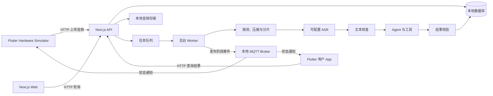

# Nota MVP 架构说明

## 架构图



## 组件职责

### Next.js

Next.js 同时承载网页和 HTTP API，减少项目数量与重复类型定义。API 只负责接收音频、创建任务和查询结果，不在上传请求中等待 AI 完成。

### Worker

Worker 从队列取任务，依次调用音频处理、ASR、文本校准和 Agent。音频超过同步 ASR 的 5 分钟或体积限制时，用 FFmpeg 转成 16 kHz 单声道 MP3 并切成不超过 290 秒的分片，再顺序合并转写。每完成一步就更新任务阶段，任一步失败就结束任务。

### MQTT Broker

MQTT 只发送 `taskId`、`stage` 和时间等轻量状态，不保存完整业务结果。客户端收到通知后仍使用 HTTP 查询，因此临时断开 MQTT 不会影响数据库中的最终结果。

### Flutter 用户 App

用户 App 负责查看任务和结果，不负责录音模拟。它在前台订阅 MQTT，重新进入前台时主动通过 HTTP 同步，避免依赖后台长连接。

### Flutter Hardware Simulator

Simulator 代替真实硬件，职责刻意保持简单：录音、上传、接收任务状态。以后接入真实硬件时，只要遵守同一份上传和 MQTT 协议，服务端处理链路不需要重写。

### 模型适配层

ASR 和 Chat Model 都通过配置读取，不把供应商参数散落在业务代码中。Mock Provider 用于本地演示；OpenAI Compatible Provider 用于接入真实模型。

## 关键取舍

1. **先打通，不做全量工程化**：本地数据库、本地文件和本地 Broker 足够展示流程，不引入云存储、Redis、Kafka 或 Kubernetes。
2. **异步处理**：录音上传完成即返回 `taskId`，长时间的 ASR 与 AI 不占住 HTTP 请求。
3. **结果与通知分离**：数据库是最终状态来源，MQTT 只是实时提示。
4. **Agent 而非固定文本生成**：模型根据输入决定调用待办、提醒或历史查询工具，并把调用过程展示出来。
5. **额度按业务任务计算**：用户额度与 ASR 调用次数解耦，创建时预占、成功时核销、失败时释放。
6. **明确缩小范围**：第一版只做 happy path；异常统一失败并重新开始，让代码结构清楚、方便面试讲解。

## 建议目录

```text
nota-mvp/
├── apps/
│   ├── server/               # Next.js Web、API、Worker
│   ├── mobile/               # Flutter 用户 App
│   └── hardware_simulator/   # Flutter 硬件模拟器
├── docs/
├── data/                     # 本地数据库和上传文件，Git 忽略
└── README.md
```
