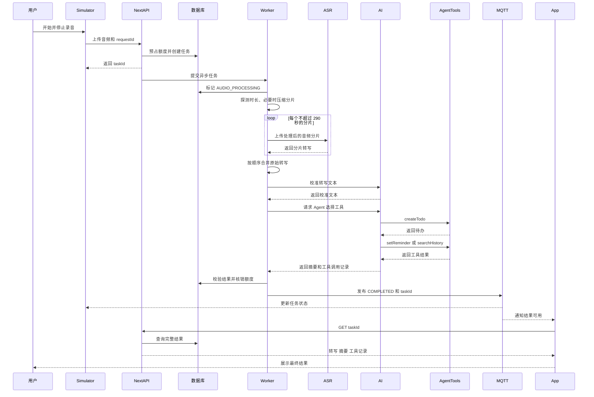
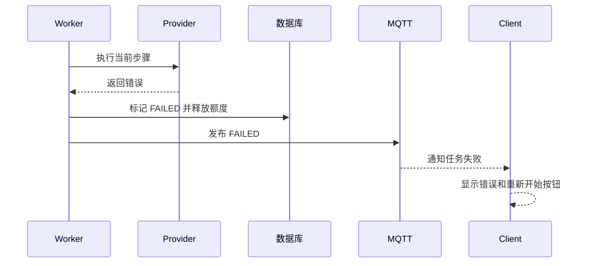

# Nota MVP 端到端时序

## Happy Path



## 阶段状态

```text
PENDING
  -> AUDIO_PROCESSING
  -> ASR_PROCESSING
  -> TEXT_CORRECTING
  -> AGENT_RUNNING
  -> RESULT_VALIDATING
  -> COMPLETED
```

任一步出错直接进入 `FAILED`，保存错误、释放预占额度，并通过 MQTT 通知客户端。客户端不从中间步骤继续，而是提示用户重新开始。

## MQTT Topic

第一版只需要一个任务 Topic：

```text
nota/tasks/{taskId}/status
```

示例消息：

```json
{
  "taskId": "task_123",
  "stage": "ASR_PROCESSING",
  "updatedAt": "2026-10-27T15:00:00.000Z"
}
```

消息不携带完整转写和摘要，防止 MQTT 成为第二套业务数据来源。

## 失败路径


